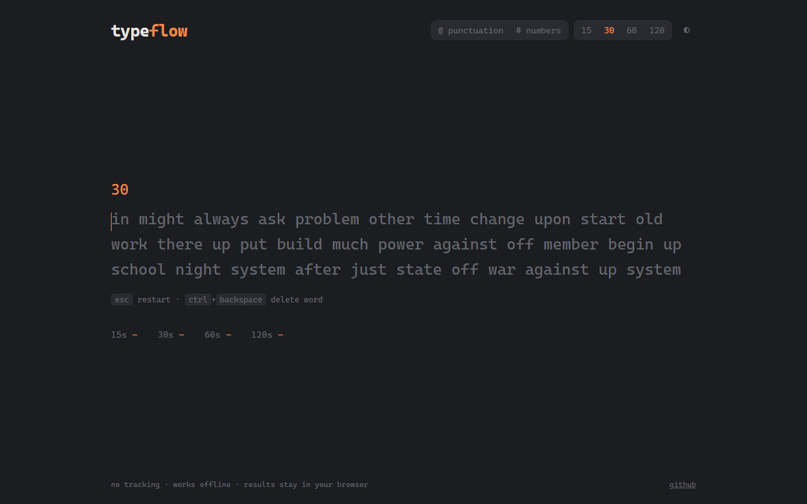

# typeflow

[](https://github.com/Tendo505/typeflow/actions/workflows/ci.yml)


A fast, minimal typing speed test that runs entirely in the browser. It shows live WPM while you type, then a breakdown of speed, accuracy and consistency with a per-second chart, and keeps a history of your results.

**▶ Live demo: https://tendo505.github.io/typeflow/**

<p align="center">
  
</p>

## Features

- **Live feedback.** Per-letter highlighting, a smooth caret, and a running WPM counter.
- **Detailed results.** Net WPM, raw WPM, accuracy, consistency score, and correct/incorrect word counts.
- **Speed chart.** A per-second graph of net WPM against raw speed, drawn on `<canvas>` with no chart library.
- **Test modes.** 15 / 30 / 60 / 120 second tests, with optional punctuation and numbers.
- **Progress tracking.** Personal bests per duration plus a recent-results table, stored locally.
- **Light and dark themes.** Follows the system setting by default, with a manual toggle.
- **Keyboard first.** <kbd>Esc</kbd> restarts, <kbd>Ctrl</kbd>+<kbd>Backspace</kbd> deletes a word, and correct words are locked once committed.
- **Zero dependencies.** Vanilla JavaScript (ES modules), HTML and CSS, with no build step, framework, tracking or network calls.

## How scoring works

TypeFlow follows the standard used by most typing tests:

| Metric | Definition |
| --- | --- |
| **WPM** | Characters in correctly typed words (plus their trailing spaces) ÷ 5, per minute |
| **Raw** | Every keystroke ÷ 5, per minute, including mistakes |
| **Accuracy** | Correct keystrokes ÷ total keystrokes |
| **Consistency** | `100 × (1 − coefficient of variation)` of per-second raw speed, so steadier typing scores higher |

## Architecture

The scoring logic is kept separate from the UI so it can be unit tested without a browser:

```
src/
├── engine.js    Pure typing state machine + scoring (no DOM)
├── words.js     Word generation with injectable RNG for deterministic tests
├── history.js   localStorage persistence with safe fallbacks
├── chart.js     Dependency-free canvas line chart (HiDPI aware, theme aware)
└── main.js      DOM rendering, input handling, timer, settings
test/            node:test suites for engine, words and history
```

- **Engine:** `createTest()` builds plain state and functions like `typeChar`, `submitWord`, `backspace` and `results` change or read it. Rendering asks the engine for `letterStates()` and `wordStatus()` instead of re-implementing comparison logic.
- **Timing:** the timer samples cumulative progress once per elapsed second (`recordSecond`). The chart and consistency score both come from that timeline.
- **Resilience:** storage access is wrapped so the app still works in private browsing or with storage blocked. Corrupt saved data is ignored rather than crashing the page.

## Running locally

ES modules need to be served over HTTP (not opened via `file://`):

```bash
npm start        # serves the folder at http://localhost:3000
```

Any static server works, e.g. `python -m http.server`.

## Tests

```bash
npm test
```

The tests use Node's built-in test runner (`node:test`), so there's nothing to install. CI runs them on Node 20 and 22 for every push and pull request, and deploys to GitHub Pages when `main` passes.

## License

[MIT](LICENSE) © Tendo505
